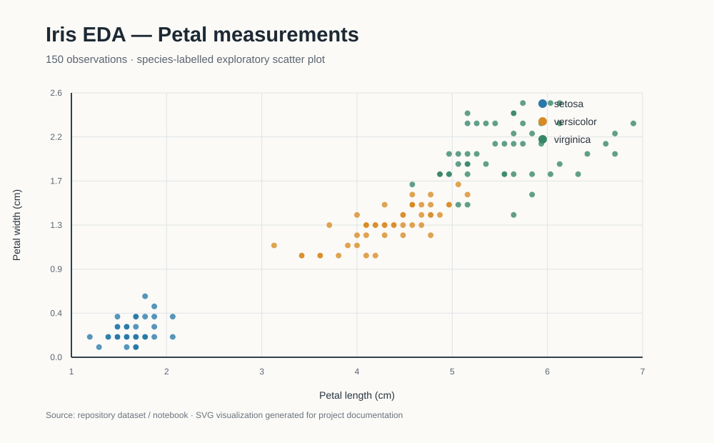
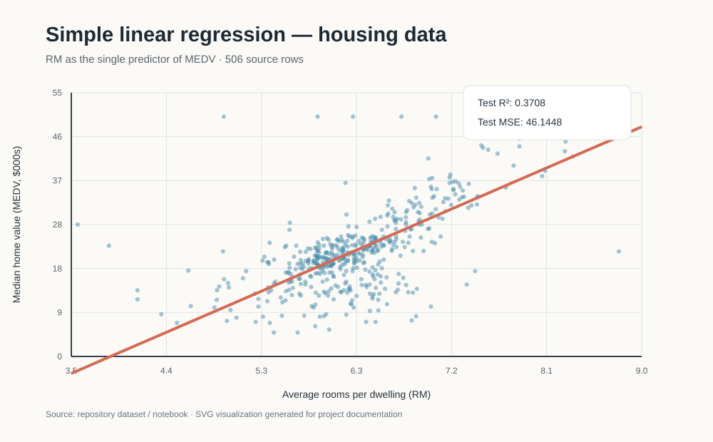
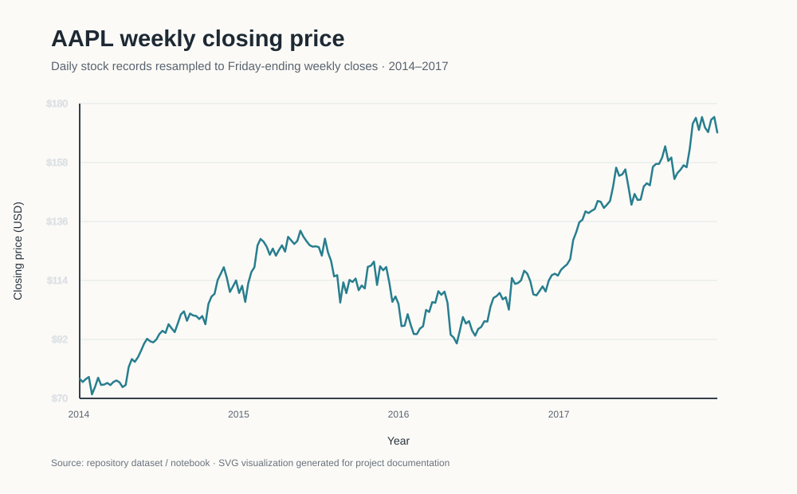
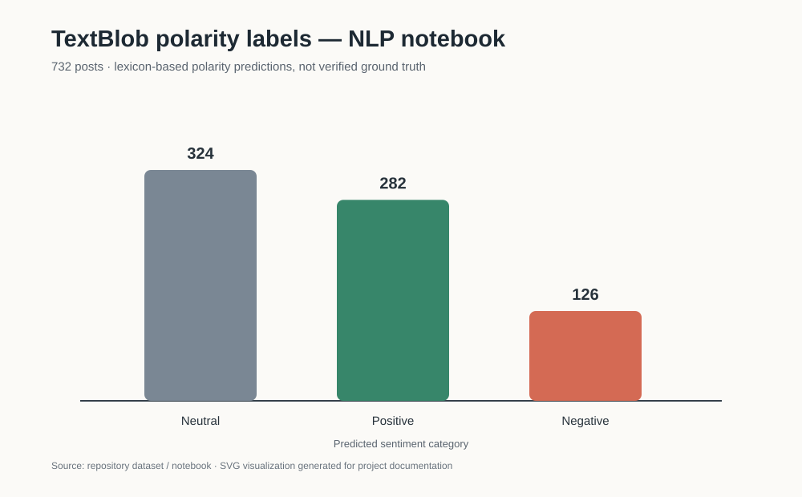
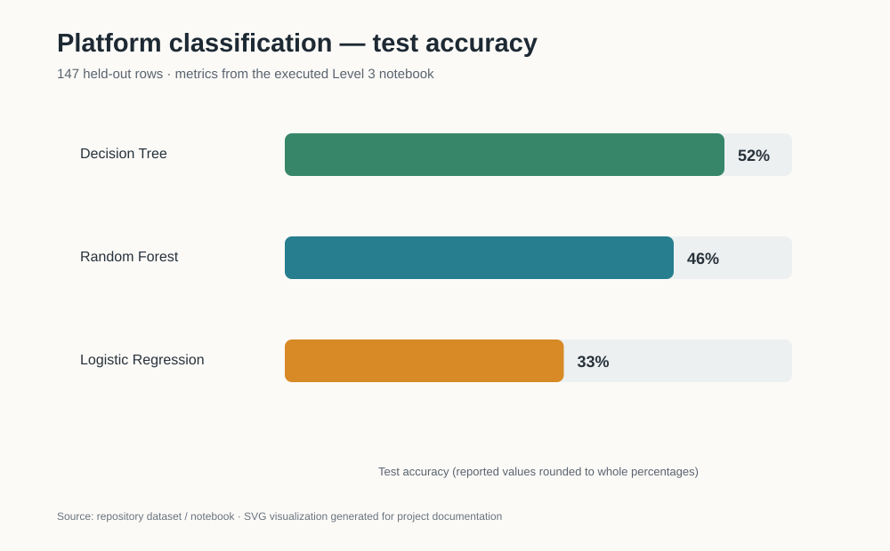

# Krish Gour — Data Analytics Portfolio

Python data analytics exercises using Pandas, NumPy, Matplotlib, Seaborn, scikit-learn and statsmodels. The repository is organized by the Codveda task levels and includes the original datasets used by the notebooks.

## Selected visual outputs

These visuals are generated from the datasets and saved notebook outputs in this repository. They are documentation assets, not screenshots of a running BI product.

### Exploratory data analysis — Iris

### Regression — housing dataset
The notebook uses average rooms (`RM`) as a single predictor of median home value (`MEDV`). The saved test-set results are R² = 0.3708 and MSE = 46.1448. This is a basic teaching exercise, not a production forecasting model.

### Time series — AAPL

### NLP sentiment — TextBlob
The saved notebook labels 732 posts by TextBlob polarity. These are lexicon-based predictions, not validated ground-truth sentiment labels.

### Classification — platform prediction
The selected target is `Platform`, not churn. Accuracy below is from the notebook's held-out test set.

## Project contents

| Area | Work |
|---|---|
| Data cleaning | Customer CSV preprocessing, normalization, date parsing, validation and export |
| Exploratory analysis | Iris descriptive statistics, distributions, boxplots, scatterplots and correlations |
| Visualization | AAPL daily stock data filtered to AAPL, with weekly trend analysis in Level 2 |
| Regression | Single-feature linear regression with train/test evaluation |
| Time series | Weekly AAPL series, seasonal decomposition and moving-average smoothing |
| Clustering | Standardization, elbow method and K-Means |
| Classification | Preprocessing pipelines, Decision Tree, Logistic Regression, Random Forest and grid search |
| NLP | Tokenization, stopword removal, stemming and TextBlob polarity |

## Running the notebooks

1. Clone this repository.
2. Install the dependencies for the relevant task. Level 2 and Level 3 contain task-specific `requirements.txt` files.
3. Open each notebook from its task folder so the relative dataset paths resolve.
4. Run cells from top to bottom.

## Limitations

These are hands-on learning and internship exercises. The repository does not claim production deployment or business impact. The Level 3 Power BI folder contains a raw dataset, Power Query script, DAX measures and a build guide; it does **not** contain a completed or published `.pbix` dashboard.
